# TooloraLabs — Architecture

Generated from the code on 2026-10-20 (no earlier Mermaid source existed in the repo).
Mermaid text, not an image: edit it in place when the structure changes.

```mermaid
flowchart TD
  subgraph PKG["packages/ — pure logic (no window/document/DOM)"]
    CORE["@tooloralabs/core<br/>contracts · engine · pipeline · registry · errors · utils"]
    SDK["@tooloralabs/sdk<br/>BaseTool · ToolBuilder · validators · AutoRegistrar"]
    TOOLS["@tooloralabs/tools<br/>calculators · converters · formatters · generators · analyzers"]
    SDK --> CORE
    TOOLS --> CORE
    TOOLS --> SDK
  end

  subgraph I18N["i18n layer — 6 locales"]
    ROUTING["i18n/routing.ts<br/>en · ar · es · hi · fr · de (default en)"]
    REQ["i18n/request.ts · i18n/navigation.ts"]
    MSG["messages/{en,ar,es,fr,de,hi}.json<br/>1:1 keys"]
    PROXY["proxy.ts<br/>next-intl middleware (skips api, _next, embed)"]
    PROXY --> ROUTING
    REQ --> MSG
  end

  subgraph WEB["apps/web — Next.js App Router"]
    DATA["data/<br/>tools.ts · categories.ts (CATEGORY_ORDER) · comingSoon.ts"]
    LIB["lib/<br/>live data: crypto · forex · commodities · weather<br/>pdf · export · currency · site · home-calculator"]
    HOOKS["hooks/<br/>useCopyToClipboard · usePrintExport"]

    subgraph PAGES["app/[locale]/"]
      HOME["page.tsx (home + calculator)"]
      TOOLPAGE["tools/&lt;slug&gt;/page.tsx (one route per tool)<br/>tools/[slug]: the 4 live-data tools"]
      TOOLSIDX["tools/page.tsx"]
      CATS["categories/[slug]"]
      DOCSPAGE["docs/[slug]/page.tsx<br/>per-tool docs page"]
      DOCSIDX["docs/page.tsx"]
      OTHER["about · contact · privacy · terms<br/>affiliate-disclosure · compare · coming-soon · embed-tools"]
    end

    EMBED["app/embed/[slug]<br/>iframe embeds (no locale prefix)"]
    API["app/api/<br/>crypto · forex · commodities · weather"]

    subgraph COMP["components/"]
      CTOOLS["tools/&lt;slug&gt;/<br/>one folder per tool<br/>+ layout/ · markets/ (shared)"]
      CDOCS["docs/&lt;slug&gt;/<br/>per-tool docs content"]
      CUI["tool-ui · layout · home · categories<br/>category-page · tools-page · embed · hero · legal"]
    end

    subgraph SEO["SEO layer"]
      SITEMAP["app/sitemap.ts<br/>static + categories + tools × 6 locales, hreflang alternates"]
      ROBOTS["app/robots.ts<br/>allow all, points to sitemap.xml"]
      META["generateMetadata per page<br/>title · description · canonical · languages · openGraph"]
      LD["JSON-LD (structured data)<br/>WebApplication + Offer on tool pages"]
    end
  end

  EXT["Free keyless external APIs<br/>(market prices, weather)"]

  TOOLPAGE --> CTOOLS
  TOOLPAGE --> META
  TOOLPAGE --> LD
  DOCSPAGE --> CDOCS
  DOCSPAGE --> META
  DOCSPAGE -.->|"DOCUMENTED_TOOL_SLUGS<br/>lib/docs-tools.ts"| LIB
  CATS --> DATA
  TOOLSIDX --> DATA
  HOME --> LIB
  EMBED --> CTOOLS
  CTOOLS --> TOOLS
  CTOOLS --> LIB
  CTOOLS --> HOOKS
  CTOOLS --> CUI
  LIB --> API
  API --> EXT
  SITEMAP --> DATA
  SITEMAP --> ROUTING
  ROBOTS --> SITEMAP
  META --> ROUTING
  PAGES --> MSG
  COMP --> MSG
  PROXY --> PAGES
```

## Layers in one line each
- **packages/** — framework-free logic shared with the future mobile app: `core` (engine, registry, pipeline), `sdk` (tool authoring contracts), `tools` (the tool implementations).
- **i18n** — six locales via next-intl; `proxy.ts` adds the locale prefix; every UI string lives in `messages/*.json` with identical keys.
- **Pages** — `/{locale}/tools/{slug}` renders the tool: each tool has its own route folder `app/[locale]/tools/<slug>/page.tsx` that passes its server entry `components/tools/entries/<slug>.tsx` to `lib/tool-page.tsx` (Next.js splits client JS per route, so a tool page loads only its own tool's code); `tools/[slug]` serves the four live-data tools on first request. A new tool needs both files. Client messages: `lib/client-messages.tsx` ships only the namespaces a page needs (`data/client-message-deps.json`, generated pre-build); `/{locale}/docs/{slug}` renders its long-form docs (only slugs in `DOCUMENTED_TOOL_SLUGS`).
- **Live data** — `lib/{crypto,forex,commodities,weather}` call the app's own `app/api/*` routes, which proxy free keyless sources.
- **SEO** — `sitemap.ts`, `robots.ts`, `generateMetadata` (canonical + hreflang) and JSON-LD on tool pages.

## ملاحظات معمارية معلّقة
1. **محرّك التعبيرات وحالة الحاسبة** — `apps/web/lib/home-calculator/` (expressionEngine, graphEngine, unitConversions, formatNumber) ومعه `apps/web/components/home/calculator/homeCalculatorReducer.ts` منطقٌ خالص مكانه `packages/tools`. بقاؤه في التطبيق يخالف هدف إعادة الاستخدام في تطبيق الموبايل. يُنقل حين يبدأ تطبيق الموبايل، لا قبله.
2. **`packages/sdk`** يظهر طبقةً واحدة باهتة (12 استيراداً فقط، كلها من `packages/tools`، ولا يستورده `apps/web`). يُراجَع: هل يستحق أن يبقى حزمة مستقلة أم يُدمج في `core`.
3. **`components/tools/layout/` و`components/tools/markets/`** ليسا أداتين، ويخرقان قاعدة «مجلد لكل أداة» داخل `components/tools/`. مكانهما المرشّح `components/tool-ui/` أو مجلد مشترك مستقل.
